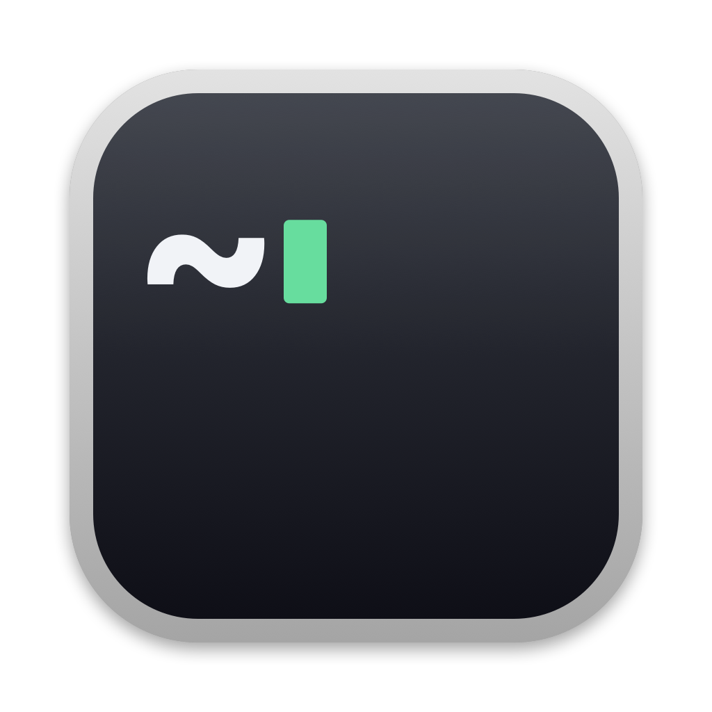
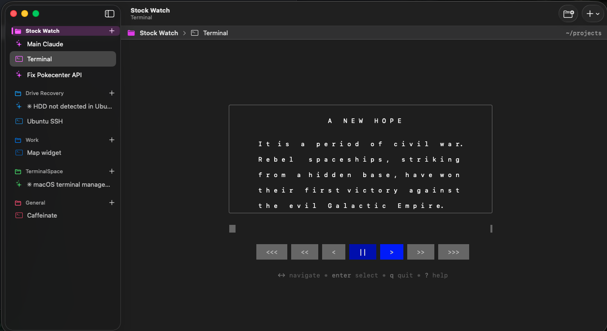

<p align="center">
  
</p>

# TerminalSpace

TerminalSpace is a native macOS terminal app that puts your terminals into workspaces.
Each workspace is a project folder. Each terminal in a workspace can be a normal shell,
a [Claude Code](https://claude.com/claude-code) session, an [opencode](https://opencode.ai) session,
or any command that you configure, for example `ssh`.

The app uses [SwiftTerm](https://github.com/migueldeicaza/SwiftTerm) for terminal emulation.



## Features

- **Workspaces:** A sidebar shows your workspaces. The terminals of each workspace show under it.
- **Launchers:** The new-terminal menu shows a list of launchers. Each launcher has a name, an icon, and a command. The default launchers are Terminal, Claude, and opencode. Add your own, for example `ssh user@host`. The command starts in the workspace folder. When it stops, the tab continues as a normal shell.
- **Run Command:** Start any command one time, or save it as a launcher.
- **Link actions:** Let a different program, for example a browser plugin, open a workspace and a terminal with a `terminalspace://` link. Off until you add an action.
- **Drag files in:** Drag a file or a folder into a terminal to type its path. Dragged text also goes in.
- **Claude session names:** A new Claude session gets the name of its workspace. The name shows in the Claude prompt box, in the `/resume` list, and in the tab.
- **Drag and drop:** Drag a terminal to a different workspace, or to a different position. Drag a workspace name onto a different workspace to change the order of workspaces.
- **Restore:** When you quit, the app saves your terminals. At the next start:
  - A Terminal tab shows its last output and opens a shell in its last folder.
  - A tab from a custom launcher shows its last output. By default, it runs its command again.
  - A Claude tab resumes the same conversation, also after `/resume` or `/clear`.
  - An opencode tab continues the last session in the workspace folder.
- **Themes:** The themes follow the profiles of the macOS Terminal app: Basic, Pro, Homebrew, Ocean, Grass, Man Page, Novel, Red Sands, and Silver Aerogel. You can set a default theme and a different theme for each workspace.
- **Workspace colors:** Each workspace has a color in the sidebar. A workspace theme can also set this color.
- **Settings:** Font, font size, cursor shape, and cursor blink.

## Requirements

- macOS 14 or later
- Swift 6 toolchain (Xcode 16 or later, or the Command Line Tools)
- Optional: `claude` and `opencode` in your login shell `PATH`

## Build

```sh
git clone https://github.com/burghr/TerminalSpace.git
cd TerminalSpace
./build.sh
open build/TerminalSpace.app
```

`build.sh` builds a release binary and makes `build/TerminalSpace.app`. The app has an ad-hoc signature only.

Options:

- `./build.sh --run` stops the running copy, then opens the new build. The running copy saves its terminals before it stops.
- `build.sh` uses the Command Line Tools if Xcode cannot build the package, for example when the Xcode license is not accepted, or when the Metal toolchain for the SwiftTerm shaders is missing. To install that toolchain, run `xcodebuild -downloadComponent MetalToolchain`.

To change the icon, edit `Scripts/make-icon.swift`, then run `swift Scripts/make-icon.swift`.

## Keyboard shortcuts

| Action | Shortcut |
|---|---|
| New workspace | Shift-Cmd-N |
| First launcher (Terminal) | Cmd-T |
| Second launcher (Claude) | Shift-Cmd-T |
| Third launcher (opencode) | Option-Cmd-T |
| Launchers 4 to 9 | Control-Cmd-4 to Control-Cmd-9 |
| Run Command | Shift-Cmd-R |
| Close terminal | Cmd-W |
| Settings | Cmd-, |

The launcher shortcuts follow the order of the launchers in Settings.

Right-click a workspace to rename it, to set its color or theme, or to move it up or down. Right-click a terminal to rename or close it.

## Launchers

Open **Settings > Launchers** to add, edit, remove, or reorder launchers. Each launcher has these settings:

| Setting | Description |
|---|---|
| Name | The name in the menu, and the default name of new tabs |
| Icon | The icon in the menu and in the sidebar |
| Command | The command to run in your login shell. Leave it empty to start a normal shell. |
| Resume support | **None**, **Claude Code**, or **opencode**. See below. |

Resume support controls what happens when TerminalSpace restores a terminal:

- **None:** An option runs the command again. For example, an SSH launcher connects again.
- **Claude Code:** TerminalSpace adds `--settings`, a session ID, and `--name` with the workspace name. You can add your own flags, for example `claude --model opus`.
- **opencode:** TerminalSpace adds `--continue` to the command.

To name Claude sessions that are already open, use **File > Name All Claude Sessions**, or **Name Claude Sessions** in the menu of a workspace, or **Name Claude Session** in the menu of a terminal. TerminalSpace then types `/rename` into those terminals. It uses your tab name, or the workspace name.

A terminal keeps a copy of its launcher from when it started. A change to a launcher does not change terminals that are already open.

## Link actions

A link action lets a different program open a terminal with a `terminalspace://` link. For example, a browser plugin can open a workspace for the page that you look at. TerminalSpace has no link actions after you install it. A link does nothing until you add an action in **Settings > Links**.

Each action has these settings:

| Setting | Description |
|---|---|
| Name | The host of the link: `terminalspace://<name>?…` |
| Parameters | A name and a pattern for each value. The link must give each parameter one time, and the pattern must match the whole value. |
| Accept data | The link can also bring JSON data. See below. |
| Workspace name | The workspace to create or to select. It can use placeholders. |
| Folder | The folder of a new workspace |
| Launcher | The launcher for the new terminal |
| Arguments | One argument on each line. TerminalSpace adds them after the command of the launcher. |
| Ask before open | TerminalSpace shows the values and asks before it opens the link. This is on for each new action. |

Placeholders in the workspace name and in the arguments:

- `{name}`: the value of the parameter `name`.
- `{name:8}`: the first 8 characters of that value.
- `{data_file}`: the path of the saved data.

A link can only give values. The action sets the folder, the launcher, and the arguments. TerminalSpace puts each argument in shell quotes, so a value cannot add a command. If the workspace already has a running terminal of the launcher, TerminalSpace selects that terminal and does not start a second one. A restored terminal does not use the arguments again.

**Data.** With **Accept data**, the link must have one of these:

- `data=<base64url JSON>`, up to 64 KB.
- `source=download`. The program first saves `terminalspace-<action>-<first parameter>.json` in `~/Downloads`, up to 1 MB. TerminalSpace removes that file after it reads it.

TerminalSpace checks that the data is JSON. Then it saves the data to `link-data/<action>/<first parameter>.json` in its data folder. The first parameter names the file, so its value can have letters, digits, `-`, and `_` only.

Example: the action `ticket` with the parameter `id`, the launcher Claude, and the argument `Read {data_file} and summarize ticket {id}`. The link `terminalspace://ticket?id=T123&data=…` then opens the workspace and starts Claude with that prompt.

Any web page can open a `terminalspace://` link. Keep **Ask before open** on, unless you trust each program that sends the link. A browser also asks before a site opens the link for the first time.

## How Claude sessions resume

A Claude conversation can change its ID, for example after `/resume` or `/clear`. To track the current ID, TerminalSpace starts Claude with `--settings`. That settings file adds a `SessionStart` hook. The hook writes the current session data to a file for each terminal. Your own Claude settings and hooks stay active.

## Data

TerminalSpace keeps its data in `~/Library/Application Support/TerminalSpace`:

| File | Content |
|---|---|
| `workspaces.json` | Workspaces: name, folder, color, theme |
| `sessions.json` | Open terminals and the selected terminal |
| `scrollback/` | Output of Terminal tabs, from the last quit. The app deletes it after a restore. |
| `claude-settings.json` | The hook settings for Claude |
| `claude-state/` | The current Claude session of each terminal |
| `link-data/` | The data from links, one folder for each link action |

The app keeps its settings, launchers, and link actions in the `com.coconetlabs.terminalspace` defaults domain.

## Limits

- A running command stops when you quit. The terminal opens again, but you must start the command again.
- The restored output of a Terminal tab is plain text without colors.
- Two opencode terminals in the same folder continue the same session.

## License

MIT. See [LICENSE](LICENSE). SwiftTerm is also MIT licensed.
